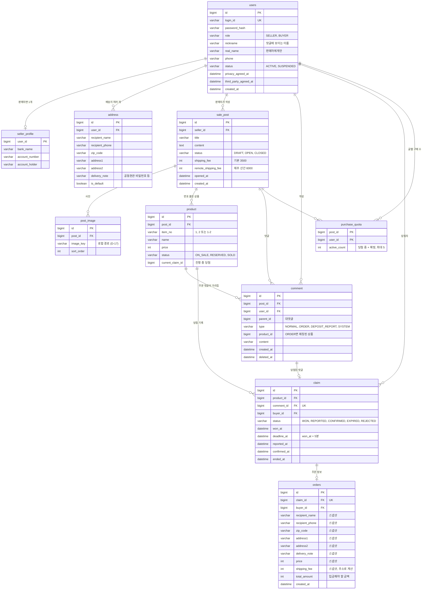

# Phase 2. ERD 초안 v1

> 2026-10-12, 상태: **v2로 대체됨** → [erd-v2.md](erd-v2.md). 결정 과정 기록용으로 남김
> 입력: [requirements.md](../requirements.md) D-01~D-18, [02 동시성](../research/02-concurrency-and-timer.md), [03 인증, 이미지, 실시간](../research/03-auth-image-realtime.md)
> ⚠️ 표시는 정수님이 정해야 하는 갈림길. 초안은 추천안 기준으로 그렸다.

## 1. 한눈에 보기



## 2. 테이블별 이유

| 테이블 | 왜 이렇게 | 버린 대안 |
|---|---|---|
| `users` + `seller_profile` | 판매자, 구매자 모두 로그인, 실명, 전화번호가 같다. 다른 건 판매자의 계좌뿐이라 그 부분만 분리. 닉네임은 구매자도 댓글에 써야 해서 `users`에 둠 (프로토타입에서 발견) | ⚠️ 1번 질문 |
| `address` | 가입 때 입력한 기본 배송지 1개 + My 페이지에서 추가한 배송지(D-24). `is_default`는 사용자당 1개만 true | 배송지를 `users` 컬럼으로 두기 (여러 배송지가 안 됨) |
| `product` | 글 본문과 별도로 상품을 구조화해 저장. `(post_id, item_no)` 유니크 | ⚠️ 3번 질문 (본문 파싱) |
| `comment` | 주문 댓글, 입금완료 댓글, 자동 감사 댓글(SYSTEM)을 한 테이블에 `type`으로 구분. 수정 API 없음(D-11), 삭제는 `deleted_at`(소프트 삭제) | 주문 댓글만 별도 테이블 (화면에서 댓글 순서를 합쳐야 해서 복잡) |
| `claim` | **당첨 한 번 = 한 행.** 차순위 승계, 재도전(D-09)마다 새 행이 생겨 이력이 남는다. 5분 상태 머신의 주인 | ⚠️ 2번 질문 (product 컬럼만) |
| `sale_post` 배송비 | 배송비 3,500원, 제주 산간 6,000원을 글마다 저장(D-25). 지금은 고정값이지만 나중에 판매자가 바꿀 수 있게 | 코드에 상수로 박기 (값이 바뀌면 과거 주문 금액 근거가 사라짐) |
| `orders` | 구매자가 **입금완료를 누르는 순간의 기본 배송지**와 가격을 **복사(스냅샷)** 해 둔다(D-24). 나중에 기본 배송지를 바꿔도 끝난 주문 주소가 안 바뀜 | `address_id`만 참조 (주소 수정 시 과거 주문이 바뀜) |
| `purchase_quota` | 글별 1인 구매 수를 카운터로 관리. 조건부 UPDATE `cnt < 5`로 원자적으로 막음(02 문서 2-B) | 매번 `COUNT(*)` (동시 요청에 6개 통과 위험) |

- 면접 질문 예시: "주문에 주소를 참조하지 않고 복사해서 저장한 이유는? 정규화 위반 아닌가요?"

## 3. 당첨 상태 흐름 (claim)

```
           정확한 첫 댓글
  (없음) ─────────────────▶ WON ── 5분 안에 입금완료 신고 ──▶ REPORTED ── 판매자 [입금확인] ──▶ CONFIRMED (판매 완료)
                             │                                  │
                             │ 5분 초과                          │ 판매자 [입금 안 됨] (R-02a, 추천안)
                             ▼                                  ▼
                          EXPIRED                           REJECTED
                             └──────────── 둘 다: 다음 순서 주문 댓글로 새 claim(WON) 생성, 없으면 product = ON_SALE
```

- 모든 전이는 **조건부 UPDATE**로 한다. 예: `UPDATE claim SET status='EXPIRED' WHERE id=? AND status='WON' AND deadline_at < NOW()`. 바뀐 행이 1일 때만 승계 진행 → 스케줄러가 두 번 돌아도, 신고와 만료가 동시에 와도 한쪽만 성공.
- `product.status`: claim이 WON/REPORTED면 `RESERVED`, CONFIRMED면 `SOLD`, 진행 중 claim이 없으면 `ON_SALE`.
- 면접 질문 예시: "상태 머신을 코드의 if문이 아니라 UPDATE 조건으로 지키는 이유는?"

## 4. 동시성 설계 (02 문서 결정의 추천 기본값)

| 상황 | 기본값 | 방어선 |
|---|---|---|
| 같은 상품에 정확한 댓글 동시 도착 | 댓글 저장 트랜잭션에서 `product` 행을 `SELECT ... FOR UPDATE`(비관적 락) 후 ON_SALE이면 claim 생성 | `claim.comment_id` 유니크, `product.current_claim_id` 조건부 UPDATE |
| "먼저"의 기준 (R-05) | **락을 잡은 순서** = 당첨 순서. 차순위는 `comment.id` 순서 | 화면에 보이는 댓글 순서(id)와 당첨 순서가 드물게 다를 수 있음 → ⚠️ 4번 질문 |
| 1인 5개 (D-13) | `purchase_quota` 조건부 UPDATE | 락 순서 고정: **product 먼저, quota 나중** (데드락 예방) |
| 5분 만료 (R-03) | `@Scheduled` 몇 초마다 `deadline_at < NOW()`인 WON을 찾아 만료 + 조회 시 지연 평가 | 서버 1대로 시작. 늘리면 ShedLock 또는 `SKIP LOCKED` |

### 인덱스 초안
- `comment (post_id, id)`: 댓글 목록 폴링(D-18) "마지막 id 이후만"
- `comment (product_id, type, id)`: 차순위 찾기
- `claim (status, deadline_at)`: 만료 스케줄러
- `product (post_id, item_no)` 유니크
- `address (user_id, is_default)`

- 면접 질문 예시: "MySQL에는 부분 유니크 인덱스가 없는데, 상품당 진행 중 당첨이 1개뿐임을 어떻게 보장하나요?" (답의 방향: `product.current_claim_id`를 조건부 UPDATE로 채우고 비우기)

## 5. 초안에 넣은 가정 (틀리면 말해주세요)
| 항목 | 가정 | 관련 |
|---|---|---|
| 취소된 사람의 예전 댓글 | 한 번 당첨된 댓글은 다시 후보가 안 됨(`claim.comment_id` 유니크). 재도전은 **새 댓글** | R-03a |
| 허위 입금완료 | 판매자에게 [입금 안 됨] 버튼 → REJECTED 후 즉시 승계 | R-02a |
| 입금완료 신고 방식 | 당첨자에게만 보이는 [입금완료] 버튼, 누르면 DEPOSIT_REPORT 댓글이 자동 작성 | R-02b |
| 배송지 선택 시점 | **결정됨(D-24):** 댓글에는 입금 정보만. 배송지는 우측 상단 My에서 관리, 입금완료를 누를 때의 기본 배송지로 `orders` 생성 | R-02c |
| 댓글 삭제 | 일반 댓글만 삭제 가능, 진행 중 당첨 댓글은 삭제 불가 | R-14 |
| 실명 노출 | ⭐ 댓글의 실명은 **판매자에게만** 보임. 주소, 연락처는 입금완료 신고(`orders` 생성) 후 판매자에게 공개 | R-08 |
| 배송비 | **결정됨(D-25):** 3,500원, 제주 산간 6,000원. 당첨마다 배송비를 따로 받음(D-26) | R-12 |
| 에디터 | 단순 textarea + 이미지 업로드 | R-09 |

## 6. 정해야 할 것 (⚠️)
1. **회원 테이블:** A. `users` 하나 + `role` + `seller_profile` (추천) / B. `seller`, `buyer` 테이블 완전 분리
2. **당첨 저장:** A. `claim` 테이블 분리, 당첨마다 한 행 (추천) / B. `product`에 `winner_id`, `deadline` 컬럼만
3. **상품 등록 (R-06):** A. 글 작성 화면에서 상품을 따로 입력 (추천) / B. 본문 텍스트 `1. 빈티지원피스`를 서버가 파싱
4. **"먼저"의 기준 (R-05):** A. 락 잡은 순서 (추천, 단순) / B. 댓글 id 순서를 엄격히 (같은 상품의 더 작은 id가 대기 중인지 확인 필요, 복잡)
